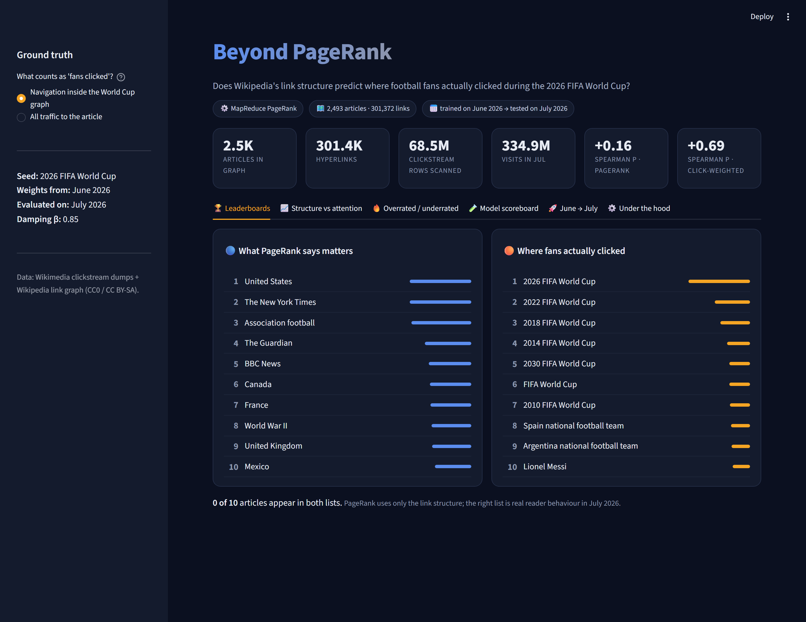

# Beyond PageRank
### Comparing structural importance with actual human navigation on Wikipedia — 2026 FIFA World Cup

BDA Mini Project (CSL702 · Experiments 11 + 12) · FRCRCE · Computer Engineering



**Live demo:** [LIVE DEMO LINK — add after deploying on Streamlit Community Cloud](#)

**Author:** Kshant Carvalho · Roll No 10232 · Group 2 · BE Computer Engineering, Sem VII (AY 2026-27)
Fr. Conceicao Rodrigues College of Engineering (FRCRCE), Bandra, Mumbai · Guide: Prof. Ankita Amburle

**Submission files** (in [`submission/`](submission/)): presentation
[`BDA_MiniProject_Kshant_10232.pptx`](submission/BDA_MiniProject_Kshant_10232.pptx) · paper
[`BDA_Paper_Kshant_10232.pdf`](submission/BDA_Paper_Kshant_10232.pdf) /
[`.docx`](submission/BDA_Paper_Kshant_10232.docx) · dashboard [screenshots](submission/screenshots/).
Both documents are generated from `results/` by `submission/build_deck.py` and `submission/build_paper.py`.

**Question:** does Wikipedia's link structure (PageRank) predict where readers actually click?
**Data:** World Cup link subgraph from the Wikipedia API + Wikimedia clickstream dumps
(June 2026 = group stage, July 2026 = knockouts & final).
**Method:** MapReduce PageRank (standard + click-weighted), baselines, out-of-sample evaluation.

---

## 1 · Results (final run, 5 Nov 2026)

**Data:** 2,493 articles · 301,372 links · 68.5 M clickstream rows scanned (34.1 M June + 34.4 M July)
· weights from June 2026, evaluated on July 2026.

**Model scoreboard — ground truth = July navigation (clicks between World Cup articles)**

| Model | Spearman ρ | Top-10 overlap | NDCG@10 |
|---|---:|---:|---:|
| PageRank (β = 0.85) | 0.161 | 0/10 | 0.058 |
| Click-weighted PageRank | **0.685** | 2/10 | 0.566 |
| In-degree | 0.334 | 2/10 | 0.360 |
| Last month's clicks (baseline) | 0.917 | 7/10 | 0.977 |

Against **all traffic** (incl. search): PageRank ρ = 0.316, click-weighted 0.685, in-degree 0.338,
last month's clicks 0.731. β sweep (navigation ρ): 0.50 → 0.189, 0.70 → 0.176, 0.85 → 0.161, 0.95 → 0.147.

**Top 5 — PageRank:** United States, The New York Times, Association football, The Guardian, BBC News
**Top 5 — click-weighted PageRank:** 2026 FIFA World Cup, United States, Donald Trump, Premier League, United Kingdom
**Top 5 — where fans navigated (July):** 2026 / 2022 / 2018 / 2014 / 2030 FIFA World Cup

**Robustness check — citation pages removed.** On the raw crawl, PageRank's top 10 was entirely
citation-identifier pages (Digital object identifier, ISBN, ISSN, PubMed, Wayback Machine …), which are linked
from reference sections. Removing 12 such pages (5,603 links) changed PageRank's ρ only from 0.156 to 0.161,
so the weak fit is not an artefact of that boilerplate. Click-weighting fixes it without any manual cleaning
(Δρ = +0.525). Results before the cleanup are kept in `results_with_citation_pages/`.

**Takeaway:** link structure measures how widely a page is *referenced* (countries, news sites, citation tools),
not where readers *go*. Weighting links by real clicks moves PageRank from ρ = 0.16 to 0.69. Last month's
clicks wins overall because attention persists; PageRank models navigation along links, not forecasting.

---

## 2 · Run it on Windows

Needs Python 3.10+ (check: `py --version`) and ~1.5 GB free disk.

Open **PowerShell** in this folder, then:

```powershell
py -m venv .venv
.\.venv\Scripts\Activate.ps1
#   if that is blocked:  Set-ExecutionPolicy -Scope CurrentUser RemoteSigned   then retry
pip install -r requirements.txt

python toy_check.py          # 1. proves the MapReduce PageRank is correct (lab manual + NetworkX)
python run_all.py            # 2. real pipeline: crawl + download + MapReduce + analysis (~1.5–2 h)
python filter_graph.py       # 3. remove citation/identifier pages from the graph (no re-crawl)
python -c "import step2_clickstream as s2, step3_analysis as s3; s2.main(['2026-06','2026-07'], skip_download=True); s3.main('2026-06','2026-07')"
                             # 4. re-run MapReduce + analysis on the filtered graph (~2 min)
streamlit run app.py         # 5. then open http://localhost:8501 (the browser no longer opens automatically)
```

**To reproduce the reported results from the existing data** (no crawl, ~2 min): copy the three files in
`data/backup_with_citation_pages/` back into `data/`, then run steps 3, 4 and 5.
⚠️ Don't run `run_all.py` again unless you want a fresh crawl: it takes ~1.5 h and builds a slightly
different graph (see Limitations).

Optional 5-second preview: `python run_all.py --mock` then `streamlit run app.py` and open http://localhost:8501
(shows a MOCK DATA banner; the real run cleans the fake files up).

What `run_all.py` does:

| Stage | File | Time (actual) | Output |
|---|---|---|---|
| Crawl seed → hop 1 → hop 2 via Wikipedia API (cached, ~1 request/s) | `step1_subgraph.py` | ~93 min (~3,700 API calls) | `data/nodes.txt`, `data/edges.tsv` |
| Download June + July clickstream (runs **in parallel** with the crawl) | `step2_clickstream.py` | ~4 min (~1 GB) | `data/raw/*.tsv.gz` |
| MapReduce aggregation of ~34M rows/month | `step2_clickstream.py` | ~1 min | `data/attention_*.tsv`, `data/edge_clicks_*.tsv` |
| PageRank ×4 β + weighted PageRank + metrics | `step3_analysis.py` | <1 min | `results/*` |

The crawl pauses 1 s after every API call and honours `Retry-After` on HTTP 429, and the User-Agent carries
contact info as Wikimedia's policy requires — without these Wikipedia rate-limits the crawl. Set your contact
before crawling: `$env:WIKI_CONTACT = "you@example.com"` (read by `config.py`). If anything stops
(Wi-Fi drop), run `python run_all.py` again: finished API batches are cached and finished downloads are kept.
If July 2026 isn't published it falls back to May → June automatically.

---

## 3 · Project structure

```
pagerank_mr.py        MapReduce PageRank engine (mapper, shuffle, reducer, driver)
toy_check.py          correctness proof: lab manual Exp 11 exact + NetworkX match
config.py             seed article, months, β values, hop-2 limits, excluded citation pages, User-Agent
step1_subgraph.py     Wikipedia API crawler -> induced 2-hop subgraph (rate-limit aware)
filter_graph.py       removes citation/identifier pages from an existing graph (no re-crawl)
step2_clickstream.py  clickstream download + MapReduce aggregation (mapper/combiner/reducer)
step3_analysis.py     4 ranking models, evaluation on the held-out month
run_all.py            one-command pipeline
app.py                Streamlit dashboard (6 tabs)
mock_data.py          fake data in the real formats, for testing only
results/                          final results (filtered graph) - committed; the dashboard needs only this
results_with_citation_pages/      results before the citation-page cleanup (robustness check)
data/backup_with_citation_pages/  graph files before the cleanup (data/ is not in git - too large)
submission/                       presentation, paper (docx + pdf), screenshots, and the scripts that build them
```

## 4 · Method in one minute

1. **Subgraph** — start at *2026 FIFA World Cup*; add every article it links to (hop 1, 1,059 pages), then
   articles linked from ≥8 hop-1 pages (hop 2, capped at 1,500 → 1,455 kept). Keep only links between
   articles in the set.
2. **Cleanup** — remove 12 citation/identifier pages (DOI, ISBN, ISSN, PubMed, Wayback Machine, …) that are
   linked from reference sections, not article content: 2,505 → 2,493 articles, 306,975 → 301,372 links.
3. **MapReduce PageRank** — each iteration is two jobs. Job 1: mapper sends
   `rank × w / Σw` along each out-link and passes the link list through; reducer sums incoming
   shares. Job 2 (map-only): adds teleport `(1−β)/N` and redistributes dead-end rank.
   Iterate until the L1 change < 10⁻⁹.
4. **Clickstream MapReduce** — mapper keeps rows whose destination is in the subgraph and emits
   per-article and per-link click counts; in-mapper combiner + reducer sum them.
5. **Four models** — PageRank (structure only), click-weighted PageRank (edge weight =
   June clicks + 1), in-degree, June clicks (naive baseline).
6. **Evaluation on July only** — Spearman ρ, top-10 overlap, NDCG@10, against
   (a) navigation = link clicks from other World Cup articles, (b) all traffic.
   Weights come from June, evaluation from July → no data leakage.

## 5 · 5-minute demo script

| Time | Show | Say |
|---|---|---|
| 0:00 | Hero + KPI cards | "Google-style ranking assumes a random surfer. Do real fans behave like that? We test it on the 2026 World Cup: 2,493 articles, 301,372 links, 68.5 million clickstream rows." |
| 0:45 | Under the hood → lab manual table | "Our MapReduce PageRank reproduces the lab manual exactly — 9/24, 15/48 — and matches NetworkX to 10⁻¹¹." Open the mapper/reducer code. |
| 1:45 | Leaderboards | "Left: what link structure says matters — United States, The New York Times, BBC. Right: where fans actually went — the World Cup pages. 0 of 10 overlap." |
| 2:30 | Structure vs attention | Move the β slider. "ρ = 0.16 at β = 0.85; lower β helps only slightly (0.19 at 0.50). Labelled outliers are the interesting ones." |
| 3:15 | Overrated / underrated | "Structure loves reference hubs — countries, newspapers, citation tools; fans chase tournaments and stars." Mention the citation-page robustness check. |
| 3:45 | Model scoreboard | "Weighted PageRank trained on June, tested on July — ρ jumps from 0.16 to 0.69, Δρ = +0.53. That's out-of-sample." |
| 4:30 | June → July | "Last month's clicks still wins (0.92): attention persists. And search dominates arrivals, which a random-surfer model can't see. That's our limitation and future work." |

## 6 · Research gap (one line)

Prior work compared PageRank with clickstream on **2016–2018** data using the **same** month for
weights and evaluation. We test it on a **2026 event-driven topic**, with **weights from one month
and evaluation on the next**, implemented in **MapReduce**.

## 7 · References

1. Page, L., Brin, S., Motwani, R., Winograd, T. (1999). *The PageRank Citation Ranking: Bringing Order to the Web.* Stanford InfoLab.
2. Dimitrov, D., Singer, P., Lemmerich, F., Strohmaier, M. (2017). *What Makes a Link Successful on Wikipedia?* WWW 2017. arXiv:1611.02508
3. Devezas, J., Nunes, S. (2021). *Fatigued PageRank.* arXiv:2104.05369 — PageRank vs Dec-2018 clickstream on Simple English Wikipedia.
4. Coquidé, C., Lewoniewski, W. (2020). *Novel version of PageRank, CheiRank and 2DRank for Wikipedia in Multilingual Network using Social Impact.* BIS 2020. arXiv:2003.04258
5. Wulczyn, E., Taraborelli, D. (2015). *Wikipedia Clickstream.* figshare / Wikimedia Research.
6. Leskovec, J., Rajaraman, A., Ullman, J. *Mining of Massive Datasets*, Ch. 5 (Link Analysis).

## 8 · Viva quick answers

- **Why a subgraph?** Full English Wikipedia is ~7M articles; a topic subgraph keeps it laptop-sized while still being real big-data processing (68 million clickstream rows).
- **Why +1 smoothing?** The clickstream hides pairs with ≤10 clicks, so a missing pair isn't zero; +1 keeps every real link usable.
- **Dangling nodes?** Their rank is collected under a special key and spread evenly — like a Hadoop counter.
- **Why two ground truths?** PageRank models link-surfing, so "navigation" is the fair test; "all traffic" shows how much attention comes from search, which PageRank cannot model.
- **Why were citation pages removed?** Nearly every article links ISBN/DOI/Wayback Machine from its references, so they topped PageRank (ISBN: 947 in-links, 280 navigation clicks). Removing them barely changed ρ (0.156 → 0.161), which shows the weak fit is real.
- **Why do news sites and countries rank high?** Articles cite newspapers and link countries from infoboxes and navboxes — structurally central, rarely clicked. That's exactly the gap the project measures.
- **Why does last month's clicks win?** Attention persists month to month, so it's a strong forecasting baseline. PageRank models navigation along links; the point is how far structure alone gets, and how much click-weighting adds.
- **Limitations:** subgraph boundary cuts outgoing rank; ≤10-click pairs hidden; redirect link targets outside the set dropped; one tournament, two months; ties at the hop-2 cap (151 pages tied at 21 in-links) are broken arbitrarily, so a fresh crawl gives a slightly different graph — sorting ties by title would make it deterministic.
